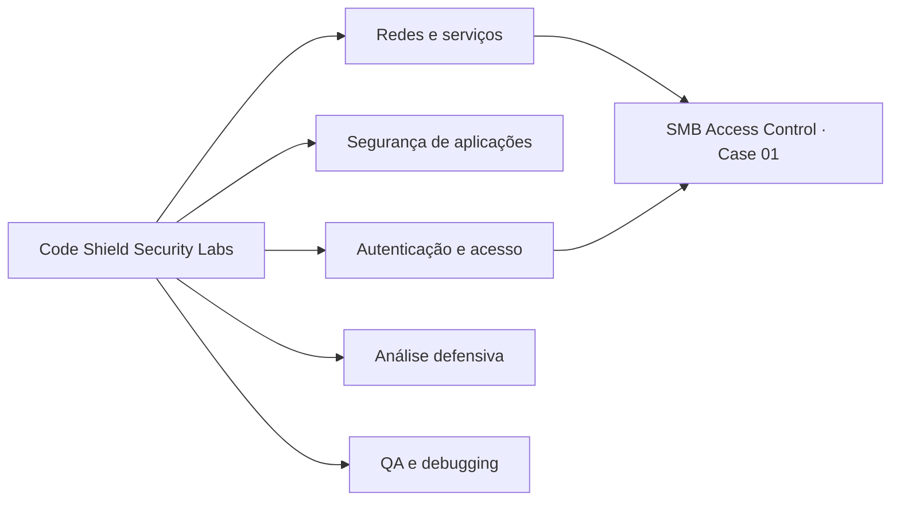

# 🛡️ Code Shield — Security Labs

**Laboratórios de cibersegurança, redes e validação de controles**, com foco em pesquisa aplicada, aprendizado prático e documentação reproduzível.


> **Investigar → testar → registrar → explicar.** O objetivo é entender como os controles se comportam, sem confundir serviço exposto, risco potencial e vulnerabilidade comprovada.

## 🔬 Laboratórios

| Case | Tema | Conteúdo | Status |
|---|---|---|---|
| [**01 · SMB Access Control**](labs/smb-access-control/README.md) | Windows, redes, SMB3 e ACLs | Descoberta de serviço, enumeração, leitura autorizada, bloqueio de acesso administrativo e gravação | ✅ Documentado |

Os próximos estudos serão adicionados à pasta `labs/`, cada qual com objetivos, ambiente, etapas, resultados e limitações próprios.

## 🧭 Áreas de estudo



**Próximos estudos possíveis:** configuração segura de serviços, análise de logs, validação de APIs, OWASP Juice Shop em laboratório local e testes de segurança de aplicações próprias. São ideias, **não testes executados**.

## 📂 Organização do repositório

```text
code-shield-security-labs/
├── README.md
├── CONTRIBUTING.md
├── labs/
│   └── smb-access-control/
│       ├── README.md
│       ├── docs/
│       │   ├── achados.md
│       │   ├── capturas.md
│       │   └── roteiro-de-testes.md
│       ├── evidencias/
│       │   ├── README.md
│       │   └── 09-escrita-negada.md
│       └── assets/
└── templates/
    └── case-study-template.md
```

## 📋 Padrão de documentação

Cada estudo deve registrar:

- **Objetivo e escopo autorizado:** o que será avaliado e onde.
- **Ambiente:** sistemas, versões, ferramentas e configurações relevantes.
- **Metodologia:** comandos/ações reproduzíveis e parâmetros sanitizados.
- **Evidências:** saídas reais com dados privados removidos; imagens opcionais.
- **Resultados:** esperado × observado, separando hipótese de descoberta.
- **Riscos e limitações:** o que o teste *não* demonstrou.
- **Conclusões:** recomendações proporcionais às evidências.

Use [o modelo de novo laboratório](templates/case-study-template.md) como ponto de partida.

## 🔒 Segurança e privacidade

Os experimentos são conduzidos **somente em dispositivos e aplicações próprios ou expressamente autorizados**.

Não armazenar credenciais, hashes sensíveis, tokens, documentos privados, dados de clientes, identificadores desnecessários de dispositivos ou capturas não revisadas. Endereços, nomes de contas e caminhos específicos podem ser substituídos por placeholders, com anotação explícita de sanitização.

**Os logs documentados devem ser reais.** Diagramas podem explicar resultados, mas nunca se passar por screenshots ou saídas de terminal.

## 📣 Sobre a Code Shield

Estes estudos compõem um portfólio técnico de aprendizado, investigação, QA e segurança defensiva. Não representam certificação de segurança nem testes de penetração completos em sistemas de terceiros.

---

**Code Shield** · *Entender o sistema, validar o controle, documentar a evidência.*