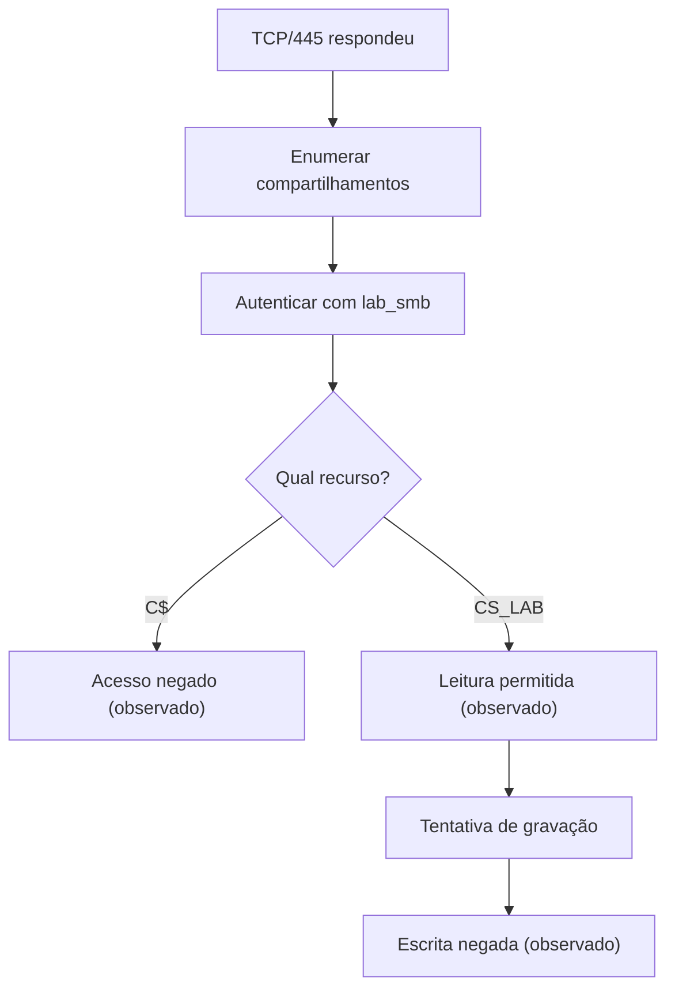

# 🛡️ Code Shield — Laboratório de Controle de Acesso SMB

**Reconhecimento de rede · Enumeração SMB · Autenticação · Autorização · Menor privilégio**

> Estudo de caso técnico, realizado em ambiente próprio e autorizado, para demonstrar como uma porta TCP aberta não é, por si só, uma vulnerabilidade.

## 🎯 Objetivo

Verificar, com uma **conta local sem privilégios administrativos**, a diferença entre:

1. Descobrir um serviço SMB disponível na porta 445;
2. Enumerar os nomes dos compartilhamentos;
3. Conseguir autenticar-se no servidor;
4. Ter autorização para **ler** um compartilhamento comum;
5. Ser impedido de acessar o compartilhamento administrativo **C$**;
6. Ser impedido de **gravar** em um compartilhamento de leitura (teste observado).

Nenhum ataque a terceiros, escalada de privilégios ou exploração de vulnerabilidade faz parte deste estudo.

## 🗺️ Ambiente

| Camada | Configuração |
|---|---|
| Máquina-alvo | Windows (notebook próprio) |
| Cliente de testes | Ubuntu 22.04 no WSL2 do mesmo notebook |
| Serviço | SMB em TCP/445 |
| Versão negociada | SMB3 |
| Conta de laboratório | `lab_smb` (não administrativa) |
| Compartilhamento permitido | `CS_LAB`, apenas leitura |
| Compartilhamento protegido | `C$`, administrativo |
| Ferramentas | PowerShell, Nmap e Samba `smbclient` |

**Limitação de escopo:** como o cliente WSL2 está no mesmo computador que o servidor, os testes **não demonstram exposição de SMB para outros computadores do Wi-Fi, nem para a internet**. É necessário repetir um teste de conectividade em outro dispositivo autorizado para avaliar esse cenário.

## 🔬 Metodologia e evidências

| ID | Verificação | Evidência obtida | Estado |
|---|---|---|---|
| 01 | Identificação da porta 445 com Nmap | Serviço SMB responde no próprio host | ✅ |
| 02 | Compartilhamentos administrativos | `ADMIN$`, `C$` e `IPC$` padrão | ✅ |
| 03 | Configuração SMB | SMB1 desativado, SMB2/3 ativo, assinatura obrigatória | ✅ |
| 04 | Políticas de firewall | Perfis ativos; bloqueio padrão de entrada | ✅ |
| 05 | Pertencimento a administradores | `lab_smb` não aparece no grupo local | ✅ |
| 06 | Enumeração com `smbclient -L` | Nomes de compartilhamentos listados | ✅ |
| 07 | Tentativa de listar `C$` | `NT_STATUS_ACCESS_DENIED` | ✅ |
| 08 | Listagem de `CS_LAB` | Leitura autorizada, confirmada no teste | ✅ |
| 09 | Envio de arquivo para `CS_LAB` | `NT_STATUS_ACCESS_DENIED opening remote file` | ✅ |

### Fluxo de verificação

## 🔐 Controle de acesso encontrado

O compartilhamento `CS_LAB` foi configurado com **permissão de compartilhamento Read** para `lab_smb`. A pasta também tem **ACLs NTFS herdadas** que merecem revisão, pois alguns grupos autenticados possuem permissões mais amplas no sistema de arquivos.

A autorização efetiva pela rede depende de **dois controles**: permissões do compartilhamento e permissões NTFS. Neste laboratório, queremos demonstrar que o acesso de leitura pelo compartilhamento não implica autorização para gravar.

> **Resultado não é sinônimo de vulnerabilidade:** o serviço disponível na rede e a enumeração dos compartilhamentos, por si só, não comprovam acesso indevido aos arquivos.

## 🧪 Reprodução (somente em ambiente próprio)

Consulte [docs/roteiro-de-testes.md](docs/roteiro-de-testes.md). Os comandos incluem placeholders para IP e não armazenam credenciais no repositório.

## 🧾 Evidências e privacidade

O [registro textual sanitizado do teste de escrita](evidencias/09-escrita-negada.md) documenta o retorno realmente observado. O endereço IP e o caminho da máquina foram substituídos por marcadores, sem alterar a mensagem de erro.

**Screenshots são opcionais.** Se o Windows impedir uma captura, não contorne os controles do sistema para obtê-la. Use saídas textuais revisadas, diagramas originais e explicações reproduzíveis. Confira as recomendações em [docs/capturas.md](docs/capturas.md).

Não publique senhas, tokens, IPs de outros equipamentos, MACs, caminhos pessoais ou informações de terceiros.

## 🧾 Conclusão dos testes realizados

Os testes **demonstraram autorização seletiva**: a conta não administrativa conseguiu ler `CS_LAB`, teve a listagem de `C$` negada e recebeu `NT_STATUS_ACCESS_DENIED` ao tentar gravar em `CS_LAB`. Isso valida os controles **nas operações e no ambiente testados**, não a segurança absoluta do servidor.

**Não foi comprovada uma vulnerabilidade explorável.** O teste também não verifica acesso externo a partir de outro host. Permissões NTFS herdadas seguem como ponto de revisão.

## ⚖️ Ética e responsabilidade

Este material descreve somente operações de consulta e autenticação em equipamento de propriedade do autor, sem exploração, adivinhação de senhas ou acesso a terceiros. Não execute verificações em redes e sistemas sem autorização.

---

**Code Shield** · Segurança de aplicações, QA e debugging · **Laboratório educacional**